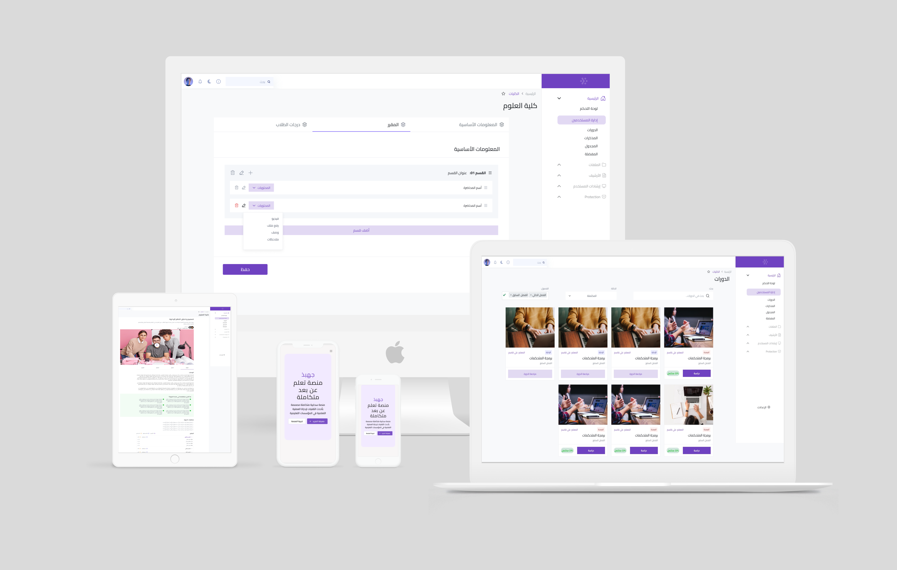

<div dir="rtl">

# منصة جَهْبَذ (Gahbaz) — المنظومة الأكاديمية الذكية للتعليم الجامعي

<div align="center">

[](https://gahbaz.netlify.app/)
[](https://elearningsystem.onrender.com/health)
[](https://elearningsystem.onrender.com/api/docs)
[-green?style=for-the-badge&logo=vitest&logoColor=white)](#الاختبارات-وضمان-الجودة)

<br/>

[](https://gahbaz.netlify.app/)

<p align="center">
  <strong>منظومة رقمية سحابية متكاملة لإدارة التعليم الجامعي ومؤسسات التعليم العالي، تجمع إدارات الكليات، هيئة التدريس، والطلاب في فضاء تعليمي متطور ومرن.</strong>
</p>

[English Documentation](README.md) • [هيكلية النظام (Architecture)](docs/ARCHITECTURE.md) • [دليل النشر والاستضافة (Deployment)](docs/DEPLOYMENT.md) • [مرجع الواجهات البرمجية (API)](docs/API.md)

</div>

---

## 🌟 الميزات الجوهرية للمنظومة

- **الهيكل الأكاديمي المؤسسي المتكامل**: إدارة شاملة للكليات، الأقسام الأكاديمية، التخصصات، الخطط الدراسية، دليل المواد العام، ونماذج الفصول الدراسية.
- **معالج تدشين الفصول الدراسية آلياً**: توليد الشعب والمقررات وتوزيع هيئة التدريس وتخصيص المناهج اعتماداً على **جلسات المعاملات الذرية في MongoDB (ACID Transactions)** مع ميزة التراجع الفوري في حال حدوث أي خطأ.
- **دفتر الدرجات والتقييم الأكاديمي المستمر**: رصد تفصيلي لدرجات الأعمال الفصلية (مشاريع، واجبات، اختبارات نصفية، اختبارات نهائية) مع تحليلات بيانية وتحقق مشدد من الحدود القصوى.
- **بوابة الحذف والإضافة والخدمة الذاتية للطلاب**: تسجيل المقررات ذاتياً مع التحقق الآلي من المتطلبات السابقة، والحدود الدنيا والقصوى للساعات المعتمدة، مع المزامنة الفورية لقوائم الحضور في المحادثات.
- **السجل الأكاديمي المعتمد وحساب المعدل التراكمي (GPA)**: احتساب المعدلات الفصلية والتراكمية وفق المعايير والسلالم الجامعية المعتمدة (A+, A, B+, B...) مع إمكانية طباعة السجل الرسمي.
- **قنوات ومحادثات المقررات التفاعلية المباشرة**: تواصل فوري ثنائي الاتجاه بالصوت والكتابة والملحقات عبر **Socket.IO** مع مزامنة فورية عند تسجيل أو حذف المقرر.
- **منصة التكليفات والواجبات الجامعية**: نشر الواجبات بملفات توضيحية، استقبال حلول الطلاب ومرفقاتهم، ورصد التقييمات والملاحظات الإثرائية.
- **منظومة التخزين السحابي متعددة المزودات**: طبقة تجريد تدعم التخزين عبر **Wasabi Hot Cloud Storage (S3)**، **Amazon S3**، **Cloudinary**، والتخزين المحلي مع روابط رفع مؤقتة مشفرة (Presigned URLs).
- **محرك المظهر الليلي/النهاري المانع للوميض**: توافق تلقائي مع إعدادات نظام تشغيل المستخدم مع كود فحص فوري وسريع في رأس الصفحة يمنع ظهور الشاشة البيضاء عند التحميل أو التحديث.
- **واجهة مستخدم عربية انسيابية (RTL)**: تصميم عصري بالكامل باستخدام **Mantine UI v6** وخط **Cairo** العربي المتناسق، مع تحميل غير معطل للصفحة الرئيسية وتجاوب تام مع الهواتف الذكية.
- **تحقق مشدد من الأسماء والبيانات الأكاديمية**: اعتماد النمط الثلاثي والرباعي للأسماء العربية وتوليد آلي لكلمات المرور المؤقتة لتسهيل تسليم الحسابات.

---

## ⚡ حسابات تجريبية جاهزة للمعاينة

النسخة التجريبية الحية على **[gahbaz.netlify.app](https://gahbaz.netlify.app/)** مزودة ببيانات أكاديمية حقيقية جاهزة للاستخدام:

| الدور | البريد الإلكتروني | كلمة المرور | الصلاحيات والمهام |
| :--- | :--- | :--- | :--- |
| **مدير النظام (Admin)** | `admin@gmail.com` | `admin123` | الهيكل الأكاديمي، تدشين الفصول، إدارة المستخدمين، الصلاحيات |
| **عضو هيئة التدريس (Teacher)** | `faisal.shammari@teacher.test` | `teacher123` | إدارة المحاضرات والدروس، رصد دفتر الدرجات، تصحيح الواجبات، قاعات المحادثة |
| **طالب جامعي (Student)** | `sara.ahmed@student.test` | `student123` | بوابة الحذف والإضافة، حضور المحاضرات، تسليم الواجبات، السجل الأكاديمي |

---

## 🛠️ حزمة التقنيات المستخدمة

### الواجهة الأمامية (`client/`)
- **الأساس**: React 18 (تطبيق صفحة واحدة SPA)، Vite 5
- **المكونات والتصميم**: [Mantine UI v6](https://mantine.dev)، Mantine React Table، Tabler Icons
- **الخطوط والاتجاه**: خط **Cairo** المدمج مع دعم الاتجاه من اليمين لليسار عبر `@emotion/react` و `stylis-plugin-rtl`
- **إدارة الحالة ومزامنة الخادم**: [TanStack Query v5](https://tanstack.com/query/latest) (React Query)
- **الاتصال الفوري**: Socket.IO Client 4.x
- **الاستضافة والنشر**: شبكة حافة [Netlify](https://gahbaz.netlify.app/) السحابية

### الخادم والواجهة الخلفية (`backend/`)
- **بيئة التشغيل**: Node.js (ES Modules)، Express.js
- **قواعد البيانات**: MongoDB 7.x و Mongoose 8.x مع دعم المعاملات الذرية متعددة الوثائق (ACID Transactions)
- **الاتصال الفوري المباشر**: Socket.IO 4.x
- **الحماية والصلاحيات**: JWT (كوكيز آمنة HTTP-Only + ترويسات Bearer)، Helmet، تقييد معدل الطلبات (Rate Limiting)
- **خدمات التخزين**: AWS SDK v3 لروابط الرفع والتنزيل لـ Wasabi / S3، وتكامل مع Cloudinary
- **التوثيق**: Swagger UI Express و OpenAPI 3.0
- **الاستضافة**: [Render](https://render.com/)

---

## 📁 هيكلية مجلدات المشروع

```
Gahbaz/
├── backend/                        # خادم Node.js و Express و Socket.IO
│   ├── src/
│   │   ├── core/                   # البرمجيات الوسيطة، معالجة الأخطاء، الأمان
│   │   ├── modules/                # الخدمات البرمجية المقسمة حسب النطاق الأكاديمي
│   │   │   ├── auth/               # التوثيق وتسجيل الدخول وإدارة الرموز
│   │   │   ├── users/              # سجل المستخدمين الموحد وبيانات الاعتماد
│   │   │   ├── colleges/           # إدارة الكليات الجامعية
│   │   │   ├── majors/             # التخصصات والخطط الأكاديمية
│   │   │   ├── subjects/           # دليل المواد الأكاديمية العام
│   │   │   ├── semesters/          # الفصول الدراسية ومعاملات التدشين الذرية
│   │   │   ├── courses/            # المقررات المطروحة، الوحدات، والدروس
│   │   │   ├── assignments/        # الواجبات الجامعية والتقديمات
│   │   │   ├── enrollment/         # بوابة الحذف والإضافة الذاتية للطلاب
│   │   │   ├── grades/             # التقييم المستمر وسجل درجات هيئة التدريس
│   │   │   ├── transcripts/        # السجل الأكاديمي الرسمي وحساب المعدل
│   │   │   ├── chat/               # غرف المحادثات الفورية ومزامنة القوائم
│   │   │   └── media/              # رفع وبث الوسائط والروابط المشفرة
│   │   ├── services/storage/       # نظام التخزين السحابي متعدد المزودات (S3/Wasabi/Cloudinary)
│   │   └── docs/                   # مواصفات وتوثيق OpenAPI / Swagger
│   └── tests/                      # الاختبارات التلقائية (141 اختبار بنسبة نجاح 100%)
├── client/                         # واجهة المستخدم الحديثة (React 18 + Mantine UI)
│   ├── src/
│   │   ├── api/                    # عميل Axios وخدمات الاستدعاءات البرمجية
│   │   ├── chat/                   # واجهة المحادثات الأكاديمية الفورية
│   │   ├── components/             # المكونات المشتركة (جداول البيانات، البطاقات، النوافذ)
│   │   ├── layouts/                # تخطيط الصفحة الرئيسي والقوائم والشريط العلوي
│   │   ├── pages/                  # صفحات النظام (العامة، الطلاب، الأساتذة، الإدارة)
│   │   ├── theme/                  # إعدادات المظهر والخطوط ودعم RTL
│   │   └── routes.jsx              # تعريف المسارات والتخطيطات المتوافقة
│   └── public/                     # الملفات الثابتة وملف تحويل المسارات لـ Netlify
├── docs/                           # التوثيق التقني وخطط التطوير المعمارية
│   ├── ARCHITECTURE.md             # التوثيق المعماري المفصل للنظام
│   ├── DEPLOYMENT.md               # دليل النشر والربط بين Netlify و Render
│   ├── API.md                      # مرجع نقاط النهاية البرمجية و Socket.IO
│   └── superpowers/                # وثائق ومواصفات التطوير التفصيلية
├── netlify.toml                    # إعدادات النشر على Netlify
└── render.yaml                     # مخطط استضافة الخادم والخدمات على Render
```

---

## 🚀 التشغيل المحلي (Local Setup)

### المتطلبات الأساسية
- [Node.js](https://nodejs.org/) (إصدار 18 أو 20)
- [pnpm](https://pnpm.io/) أو `npm`
- [MongoDB](https://www.mongodb.com/) (إصدار 6 فما فوق مع تفعيل Replica Set لدعم المعاملات)

### 1. استنساخ المستودع
```bash
git clone https://github.com/O2sa/Gahbaz.git
cd Gahbaz
```

### 2. ضبط متغيرات البيئة
إنشاء ملف `.env` في مجلد `backend/`:
```env
PORT=5000
NODE_ENV=development
MONGO_URI=mongodb://localhost:27017/gahbaz?replicaSet=rs0
JWT_SECRET=super_secret_jwt_key_gahbaz_2026
JWT_LIFETIME=7d
CLIENT_URL=http://localhost:5173

# إعدادات التخزين (اختر: local, s3, أو cloudinary)
STORAGE_PROVIDER=local
UPLOAD_DIR=uploads
```

إنشاء ملف `.env` في مجلد `client/`:
```env
VITE_API_BASE_URL=http://localhost:5000/api/v1
VITE_SOCKET_URL=http://localhost:5000
```

### 3. تثبيت الحزم وحقن البيانات التجريبية
```bash
# تثبيت حزم الواجهة الخلفية
cd backend && pnpm install

# تثبيت حزم الواجهة الأمامية
cd ../client && pnpm install

# حقن البيانات التجريبية الشاملة (من مجلد backend)
cd ../backend && pnpm seed
```

### 4. تشغيل خوادم التطوير
```bash
# تشغيل الخادم الخلفي (http://localhost:5000)
cd backend && pnpm dev

# تشغيل واجهة المستخدم (http://localhost:5173)
cd client && pnpm start
```

افتح المتصفح وتوجه إلى **`http://localhost:5173/`**.

---

## 🧪 الاختبارات وضمان الجودة

تعتمد المنصة على إطار **Vitest** لإجراء الاختبارات التكاملية لجميع الوظائف المعقدة:
```bash
cd backend
pnpm test
```
```
Test Files  34 passed (34)
     Tests  141 passed (141)
  Duration  ~13.2s
```
جميع الاختبارات (141 اختباراً) تمر بنجاح تام ودون أي تحذيرات.

---

## 📖 روابط التوثيق الإضافية

- [الهيكلية والمواصفات المعمارية الشاملة (English)](docs/ARCHITECTURE.md)
- [دليل الاستضافة والنشر على Netlify و Render](docs/DEPLOYMENT.md)
- [دليل الواجهات البرمجية وتوثيق Swagger](docs/API.md)
- [English Documentation](README.md)

---

## 📄 الترخيص وفريق العمل

هذا المشروع مرخص تحت رخصة **ISC**. تم تطويره وهندسته بعناية بواسطة **[أسامة مبخوت](https://github.com/O2sa)** وفريق عمل جهبذ.

</div>
