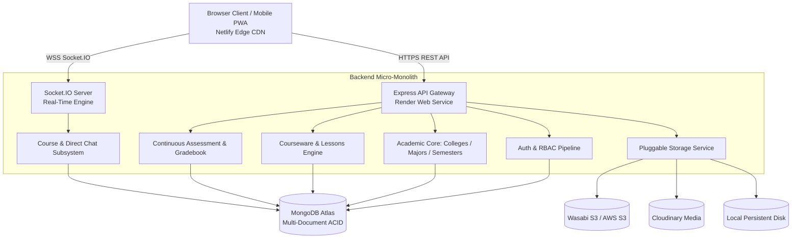

# Gahbaz (منصة جَهْبَذ) — System Architecture & Technical Specification

## 1. Executive Architectural Overview

**Gahbaz** is a multi-tier, modular academic management and e-learning platform engineered for modern universities and higher education institutions. The system facilitates end-to-end academic governance—spanning institutional hierarchies (colleges, majors, semester templates, courses), automated semester rollouts, continuous student assessment, real-time course communication, and unified user credentialing.

The platform is designed following **strict separation of concerns** and a **decoupled cloud architecture**:
- **Frontend SPA**: React 18 + Mantine UI + TanStack Query deployed as an optimized static asset bundle on **Netlify** edge network.
- **Backend API**: Node.js + Express + Socket.IO REST & WebSocket micro-monolith deployed on **Render** (or containerized Docker / Kubernetes).
- **Data Tier**: MongoDB (Atlas) multi-document ACID transactions with Mongoose ODM.
- **Media Tier**: Multi-driver storage abstraction supporting **Wasabi S3**, **Amazon S3**, **Cloudinary**, and local filesystem with streaming proxy and presigned URL capabilities.



---

## 2. Frontend Architecture (`client/`)

### 2.1 Design System & Aesthetic Foundation
- **Component Engine**: [Mantine UI v6](https://mantine.dev) with custom typography, radius, and elevation tokens.
- **Typography & Localization**: Full Arabic RTL native layout powered by Google's **Cairo** typeface and `@emotion/react` with `stylis-plugin-rtl`.
- **System-Aware Anti-Flash Theme Engine**:
  - Pre-hydration zero-delay script injected directly into HTML `<head>`.
  - Determines theme from `localStorage` (`gahbaz-color-scheme`) with dynamic fallback to OS setting (`prefers-color-scheme: dark`).
  - Sets root `data-color-scheme` and canvas background before initial paint, eliminating Flash of Unstyled Theme (FOUT).
  - Synchronous React state initialization via Mantine's `useLocalStorage({ getInitialValueInEffect: false })`.
- **Non-Blocking Public Landing Architecture**:
  - The public landing page mounts at root `/` with pathless layout separation.
  - Background session check runs with `skipAuthRedirect: true`, allowing instant rendering without waiting for network requests or showing blocking spinners.
  - Dynamically switches hero and header CTAs between visitor mode (*تسجيل الدخول / إنشاء حساب*) and authenticated mode (*لوحة التحكم / User Avatar*).

### 2.2 Routing & Layout Tree
```
RootLayout (Google Analytics 4 telemetry, Breadcrumbs provider)
├── [Public] Landing Page (/)
├── [Public] Login (/login) & Register (/register)
├── [Public] Error 404 (/404) & 500 (/500)
└── [Authenticated Pathless Layout] MainLayout (<DefaultLayout />)
    ├── Dashboard (/dashboard)
    ├── Profile (/profile)
    ├── Course Catalog (/courses)
    ├── Course Management & Syllabus (/courses/:courseId)
    ├── Course Lessons & Video Player (/courses/:courseId/lessons)
    ├── Faculty Gradebook (/courses/:courseId/grades)
    ├── Course Assignments Hub (/courses/:courseId/assignments)
    ├── Real-Time Academic Chat (/chat)
    ├── Student Add/Drop Portal (/enrollment)
    ├── Student Grades & Telemetry (/grades)
    ├── Official Academic Transcript (/transcript)
    └── Academic Administration
        ├── Colleges (/collages) & College Details (/collages/:id)
        ├── Majors (/majors) & Curricula (/majors/:majorId)
        ├── Subjects Directory (/subjects)
        ├── Semesters & Rollout Wizard (/semesters)
        └── User Directories (/users: Admins, Teachers, Students)
```

### 2.3 State Management & Server Synchronization
- **TanStack Query v5**: Centralized cache with automatic deduplication, 5-minute stale times, and optimistic UI mutations.
- **Session Isolation**: Full cache purge (`queryClient.clear()`) on user login and logout to guarantee zero cross-tenant data leakage on shared computers.
- **Unified API Client**: Axios instance configured with JWT token management, automatic 401 interceptor bypass on public routes, and standardized error notifications.

---

## 3. Backend Architecture (`backend/`)

### 3.1 Modular Domain Structure
The backend is structured into domain-driven feature modules under `backend/src/modules/`:
```
backend/src/
├── core/                   # Cross-cutting infrastructure
│   ├── middleware/         # Auth, demo guard, errors, rate-limiting
│   ├── utils/              # Response formatters, security tokens, crypto
│   └── errors/             # Custom HttpException hierarchy
├── modules/
│   ├── auth/               # Login, registration, cookies, passwords
│   ├── users/              # Unified user directory, search, names
│   ├── colleges/           # Institutional college entities
│   ├── majors/             # Academic specializations & degrees
│   ├── subjects/           # Master catalog of academic subjects
│   ├── semesters/          # Semesters, templates, atomic launch transactions
│   ├── courses/            # Offerings, sections, lessons, attachments
│   ├── assignments/        # Assignments, submissions, grading
│   ├── enrollment/         # Student self-service registration & add/drop
│   ├── grades/             # Faculty gradebook & assessment calculations
│   ├── transcripts/        # Official academic records, GPA calculation
│   ├── chat/               # Rooms, roster sync, Socket.IO handlers
│   ├── media/              # File uploads, presigned URLs, streaming
│   └── system/             # Health metrics, server telemetry
├── services/
│   └── storage/            # Multi-driver storage subsystem
└── docs/                   # Swagger / OpenAPI specification
```

### 3.2 Key Subsystems & Business Invariants

#### A. Multi-Document Atomic Semester Launch
Launching a semester automatically instantiates courses, assigns faculties, links syllabus sections, and seeds gradebooks. This workflow executes inside an **atomic MongoDB transaction session** with automatic rollback on error:
```javascript
const session = await mongoose.startSession();
session.startTransaction();
try {
  // 1. Create semester instance
  // 2. Resolve major course templates and subject overrides
  // 3. Instantiate course offerings and section syllabi
  // 4. Provision default course chat channels
  await session.commitTransaction();
} catch (err) {
  await session.abortTransaction();
  throw err;
} finally {
  session.endSession();
}
```

#### B. Pluggable Storage Driver Pattern
Media storage is decoupled behind a unified `StorageDriver` interface:
```javascript
class StorageDriver {
  async upload(file, options) {}
  async delete(key) {}
  async getUrl(key, options) {}
  async getStream(key) {}
}
```
Available drivers:
1. `LocalDiskDriver`: Fallback for local development or Docker persistent volumes.
2. `S3CompatibleDriver`: High-performance object storage supporting **Wasabi Hot Cloud Storage**, **AWS S3**, **MinIO**, and **Cloudflare R2** with presigned upload/download URLs.
3. `CloudinaryDriver`: Image and video optimization with dynamic transformations.

#### C. Real-Time Chat & Roster Synchronization
- Every academic course offering automatically provisions a synchronized Socket.IO channel (`courseId`).
- When students add or drop courses via `/api/v1/enrollment`, the system automatically synchronizes the chat roster, guaranteeing only active students and teachers have access to course discussions.
- Built-in pagination and URL deep-linking (`/chat?roomId=...`) allow instant context switching between course channels and direct messaging.

#### D. Strict Arabic Name & Credential Validation
Users are validated using comprehensive 3-part / 4-part Arabic naming rules (`الأول الأب الجد العائلة`):
- Eliminates unstructured single-string names.
- Automatic virtual property fallbacks for backwards compatibility.
- Administrator creation endpoints return securely generated temporary passwords (`tempPassword`) for physical or electronic credential distribution.

---

## 4. Security & Compliance

| Layer | Implementation |
| :--- | :--- |
| **Authentication** | JWT tokens stored in HTTP-Only cookies with fallback to `Authorization: Bearer` headers. |
| **RBAC Authorization** | Role-based middleware verifying `admin`, `teacher`, or `student` capabilities. |
| **Demo Safeguard** | `enforceDemoReadOnly` middleware blocks mutative operations on shared live demo accounts (`DEMO_MODE=true`). |
| **Input Sanitization** | `express-mongo-sanitize` prevents NoSQL injection attacks. |
| **HTTP Headers** | `helmet` configured with cross-origin resource sharing policy for static media. |
| **Rate Limiting** | Strict IP-based throttling on authentication routes (`/api/v1/auth/login`, `/register`). |
| **Tenant Isolation** | All course and subject CRUD queries enforce university scope matching the authenticated tenant. |

---

## 5. Testing & Verification

The backend utilizes **Vitest** for unit, integration, and E2E API testing:
- **Test Files**: 34 passed
- **Total Tests**: 141 passed (100% green)
- **Execution Command**: `pnpm --filter backend test` (or `vitest run`)
- **Key Suites**:
  - `tenant-isolation.test.js`: Multi-tenant isolation enforcement.
  - `semester-transaction.test.js`: Transaction rollback verification.
  - `grades-gradebook.test.js`: Continuous assessment calculations.
  - `enrollment.test.js`: Add/drop credit limits and roster synchronization.
  - `assignments.test.js`: Submission workflow and grading limits.
  - `auto-course-chat.test.js`: Automatic channel provisioning.
  - `storage.test.js`: Driver factory and Wasabi/S3 fallback logic.
