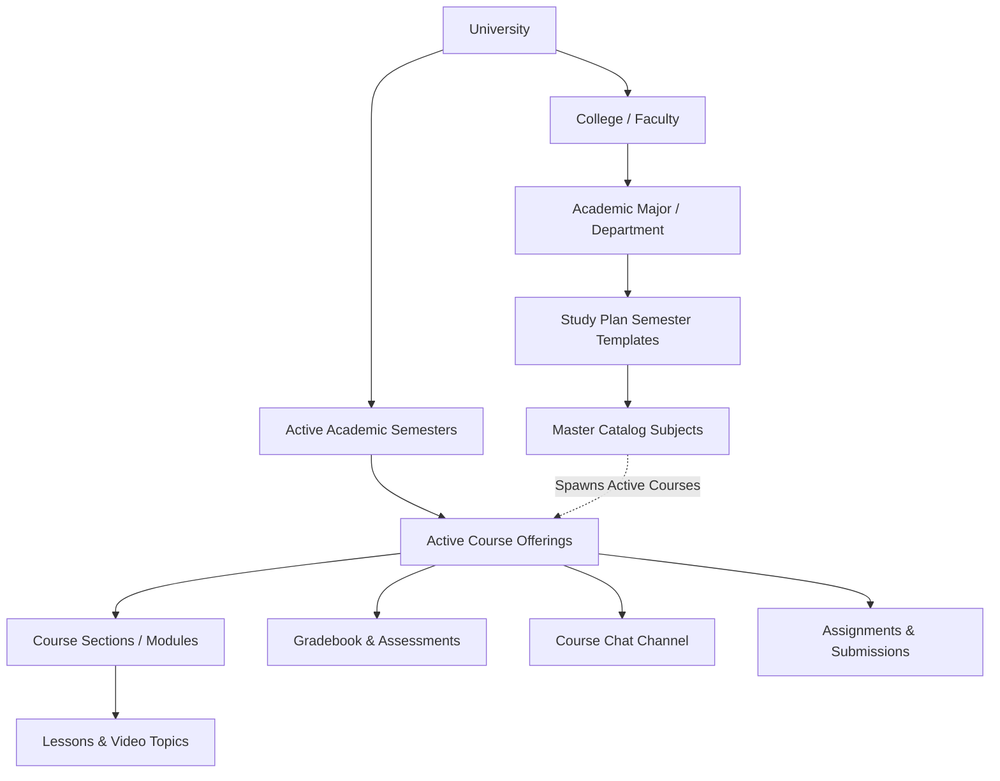

# Business Requirements & Domain Architecture Specification
## Gahbaz Academic Management & E-Learning Platform

- **Project:** Gahbaz Higher Education Academic Platform (LMS & SIS)
- **Status:** Approved Strategic Baseline
- **Date:** 2026-10-13
- **Language:** English

---

## 1. System Vision & Executive Scope

**Gahbaz** is an integrated higher education platform unifying a modern **Learning Management System (LMS)** with a comprehensive **Student Information System (SIS)**. 

The platform is designed with a multi-tenant institutional architecture, enforcing strict institutional data isolation via `universityId` across all operational endpoints. It provides dedicated, role-specific portals for:
1. **University Administrator (University Admin)**
2. **Faculty Member / Instructor (Teacher)**
3. **Undergraduate / Graduate Student (Student)**
4. **Platform Super Administrator (Super-Admin)**
5. **Prospective Students & Visitors (Public)**

---

## 2. Academic Hierarchy & Domain Supply Chain

The platform models the standard higher education institutional structure through a strict multi-level hierarchy:

### 2.1 University (`University`)
- The top-level tenant entity.
- All institutional records, faculties, programs, staff, and students are scoped to `university: ObjectId`.
- Governed by a designated Chief University Administrator (`university.admin`).

### 2.2 College / Faculty (`College`)
- Belongs directly to a University.
- Defines total graduation semesters / program length (`numberOfSemesters`).
- Encompasses academic departments and majors.

### 2.3 Academic Major / Department (`Major`)
- Belongs to a specific College.
- Defines curriculum degree requirements, department description, and level-by-level study plan templates.

### 2.4 Semester Templates (`SemesterTemplate`)
- Represents the recommended benchmark study plan for each academic level (Level 1, Level 2, ...).
- Maps the set of master catalog subjects (`subjects`) that students in that level are expected to take.

### 2.5 Master Catalog Subjects (`Subject`)
- The immutable academic course blueprint (Course Code, Name, Credit Units `unit`, Prerequisites `requirements`).
- Persists permanently in the college catalog and serves as the template for generating active course sections each semester.

### 2.6 Active Academic Semesters (`Semester`)
- A time-bound operational academic cycle (e.g., Fall 2026/2027, Spring 2027) with defined start/end dates and an `active` status flag.
- **Semester Launch Workflow (`startSemesterService`)**: Programmatically instantiates active courses (`Course`) from the curriculum semester templates for the target term.

### 2.7 Active Course Offerings (`Course`)
- An active course section instantiated for a specific semester, derived from a master `Subject`.
- Assigned to one or more instructors (`teachers`) and enrolled students (`students`).
- Houses the syllabus outline (`sections`), video lectures and interactive text topics (`lessons`), learning outcomes (`willLearn`), and course cover media.

---

## 3. User Personas & Role-Based Access Control (RBAC)

| Role | Current Capabilities | Approved Strategic Enhancements |
| :--- | :--- | :--- |
| **University Admin (`admin`)** | • Manages colleges, majors, study plans, and catalog subjects. • Launches and configures academic semesters and course offerings. • Manages faculty, student rosters, and administrative accounts. • Monitors real-time server health and security audit logs. | • Configures Add/Drop periods and enrollment policies. • Approves final semester grade submissions. • Generates and signs official university transcripts and academic standings. |
| **Faculty / Instructor (`teacher`)** | • Views assigned courses and enrolled student lists. • Authors course syllabus, sections, video lectures, and text topics. • Records and modifies continuous assessment and exam grades. • Participates in university discussion rooms. | • Publishes assignments with submission deadlines and rubric attachments. • Reviews student file submissions and provides qualitative feedback. • Moderates dedicated automated course chat channels. |
| **Student (`student`)** | • Views active term timetable and enrolled courses. • Streams video lectures and reads interactive syllabus content. • Inspects itemized grades (assignments, midterm, final). • Participates in peer-to-peer and group messaging. | • Self-service Add/Drop course registration portal within credit unit limits. • Digital assignment submission portal supporting PDF/ZIP files. • Official academic transcript with weighted semester and cumulative GPA (CGPA). |
| **Super Admin (`super-admin`)** | • Global platform governance across multiple university tenants. • Provisions new universities and manages tenant licensing. | • Centralized tenant resource utilization and aggregated metrics dashboard. |

---

## 4. Digital Course Delivery & Learning Management (LMS)

1. **Modular Syllabus Architecture:**
   - Courses are broken down into thematic modules (`Sections`).
   - Each section houses an ordered list of lectures (`Lessons`).
   - Lesson content supports:
     - **Video Streams:** Media URL with duration in minutes.
     - **Interactive Topics:** Rich HTML reading material with estimated reading time.
2. **Learning Experience:**
   - Seamless lecture navigation with dedicated video viewer (`Lessons.jsx`, `CourseLesson.jsx`).
   - Aggregated study time calculations per section and overall course.

---

## 5. Assessment & Academic Grading Engine (SIS)

1. **Continuous Assessment Breakdown (`GradeSchema`):**
   - Supports flexible multi-component evaluation:
     - **Coursework & Tasks (`assignments`):** Default max 20 points.
     - **Midterm Examination (`midterm`):** Default max 30 points.
     - **Final Examination (`final`):** Default max 50 points.
   - Built-in automatic recalculation of total score and percentage (`recalculateTotal`).
2. **Gradebook Workflows:**
   - Tabular grade entry interface for faculty to grade student rosters efficiently.
   - Student portal view displaying real-time grades and performance distribution.

---

## 6. Academic Collaboration & Real-Time Messaging

1. **Chat Infrastructure (`Chat` & `Message`):**
   - Direct 1-on-1 private messaging across students and faculty within the university.
   - Multi-participant group discussions with designated group administrators.
2. **Real-Time Communication:**
   - Powered by WebSocket (Socket.IO) handling real-time delivery, typing notifications, and read indicators.

---

## 7. Platform Intelligence, Auditing & Governance

1. **Security & Audit Trails (`AuditLog`):**
   - Captures authentication events, IP addresses, failed login attempts, and privileged data mutations.
2. **System Health Metrics (`PerformanceMetric`):**
   - Periodic snapshots of server load (CPU %, RAM %, Disk %, and Uptime).
3. **Administrative Dashboard:**
   - High-level KPI summary cards (Total Colleges, Majors, Active Courses, Faculty, Students, and System Resource Graphs).

---

## 8. Approved Enhancement Modules (Roadmap)

Following strategic requirement alignment, the following four enhancement packages have been prioritized for implementation:

### 8.1 Hybrid Course Enrollment & Add/Drop Portal
- **Mechanism:**
  - Upon launching an academic term, students are automatically pre-registered into courses designated in their major's semester study plan (`SemesterTemplate`).
  - An administrative enrollment window (Add/Drop Period) enables students to:
    - Drop a course or register for elective / prerequisite-cleared backlog courses.
    - Validate enrollment against minimum/maximum credit hour policies (e.g., 12 to 19 credit units).
    - Enforce prerequisite checks (`requirements`) based on previously passed courses.

### 8.2 Full Assignment & Deliverables Engine
- **Mechanism:**
  - Dedicated `Assignment` model linked to courses:
    - Title, instructions, attachment file URL, maximum score, and due date timestamp (`dueDate`).
  - Student submission interface:
    - Digital file upload supporting PDF, ZIP, and document formats.
    - Live countdown timers, late submission flags (`isLate`), and submission status.
  - Faculty grading portal:
    - Review submitted files, input scores, and provide written feedback.
    - Synchronizes grades directly into the student's official gradebook (`Grade`).

### 8.3 Automated Course Communication Channels
- **Mechanism:**
  - Automatically provisions a dedicated course discussion channel (`Chat`) upon course creation.
  - Designates the assigned instructor as the group administrator (`groupAdmin`).
  - Automatically syncs group members with the course's enrolled student roster (adding students upon registration, removing on drop).
  - Pinned syllabus announcements and direct course resource sharing.

### 8.4 Cumulative GPA & Official Academic Transcript Engine
- **Mechanism:**
  - Calculates semester GPA (SGPA) and cumulative GPA (CGPA) weighted by course credit units (`unit`).
  - Converts numerical scores to official letter grades (A+, A, B+, B, C+, C, D+, D, F).
  - Provides a printable, exportable Official Academic Transcript displaying term-by-term performance and graduation standing.
