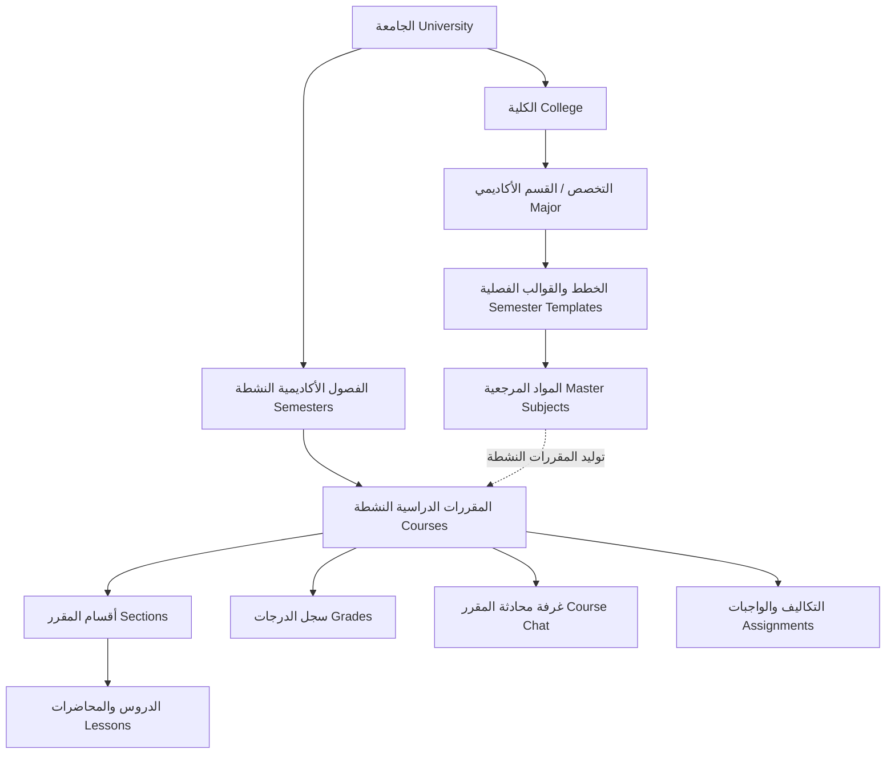

# وثيقة المتطلبات الوظيفية والمعمارية لمنصة جهبذ الأكاديمية (Gahbaz Platform)
## Comprehensive Business Requirements & Domain Architecture Specification

- **Project:** منصة جهبذ للتعليم الجامعي الإلكتروني (Gahbaz E-Learning & SIS)
- **Status:** Approved Strategic Baseline
- **Date:** 2026-10-13

---

## 1. الرؤية العامة للنظام (System Vision & Scope)

**منصة جهبذ (Gahbaz)** هي نظام جامعي أكاديمي متكامل يجمع بين نظام إدارة التعلم الإلكتروني (**LMS - Learning Management System**) ونظام إدارة معلومات الطلاب والأكاديميا (**SIS - Student Information System**). 

المنصة مصممة لمعمارية متعددة المؤسسات (**Multi-Tenant**) تعتمد على عزل البيانات بالجامعة (`universityId`)، وتوفر بوابات تفاعلية مخصصة لكل من:
1. **مدير النظام / الجامعة (University Admin)**
2. **عضو هيئة التدريس (Teacher / Faculty Member)**
3. **الطالب الجامعي (Student)**
4. **المشرف العام (Super-Admin)**
5. **الزائر والجمهور (Public / Prospective Students)**

---

## 2. الهيكل الأكاديمي وسلسلة التوريد التعليمية (Academic Hierarchy Domain)

يعتمد النظام تسلسلاً هرمياً محكماً يمثل الهيكل الجامعي الحقيقي:

### 2.1 الجامعة (University)
- تمثل الكيان المؤسسي الأعلى.
- يتم ربط كافة الكيانات والبيانات بها عبر `university: ObjectId`.
- يحدد لها مدير رئيسي (`university.admin`).

### 2.2 الكلية (College)
- تنتمي للجامعة مباشرة.
- تحدد عدد الفصول الدراسية الإجمالية للتخرج (`numberOfSemesters`).
- تحتضن مجموعة من التخصصات الأكاديمية.

### 2.3 التخصص الأكاديمي (Major)
- ينتمي لكلية محددة.
- يحتوي على وصف تفصيلي والخطة الدراسية الكاملة للتخصص.
- يقسم المسار التعليمي إلى مستويات وفصول دراسية عبر "قوالب الفصول".

### 2.4 قوالب الفصول الدراسية (Semester Templates)
- تمثل الخطة الاسترشادية لكل مستوى دراسي (المستوى 1، المستوى 2، ...).
- تتضمن قائمة المواد الأكاديمية المرجعية المقررة لهذا المستوى (`subjects`).

### 2.5 المواد المرجعية (Master Subjects)
- التوصيف الأكاديمي الثابت للمادة (رمز المقرر، الاسم، الساعات المعتمدة `unit`، المتطلبات السابقة `requirements`).
- تظل موجودة في دليل الكلية وتستخدم لتوليد المقررات النشطة فصلاً بعد فصل.

### 2.6 الفصول الأكاديمية النشطة (Active Semesters)
- دورة زمنية محددة (مثل: الفصل الدراسي الأول 2026/2027) ذات تاريخ بداية ونهاية وحالة تشغيل (`active`).
- وظيفة **بدء الفصل (`startSemesterService`)**: تقوم تلقائياً بتحويل المواد المدرجة في قوالب التخصصات إلى مقررات نشطة (`Courses`) مرتبطة بهذا الفصل.

### 2.7 المقررات الدراسية النشطة (Active Courses)
- مقرر فعلي مشتق من المادة المرجعية، يدرس في فصل دراسي محدد.
- يعين له أستاذ أو أكثر (`teachers`) وقائمة الطلاب المسجلين (`students`).
- يحتوي على خطة المحتوى الدراسي (`sections` & `lessons`)، ومخرجات التعلم (`willLearn`)، وغلاف للمقرر.

---

## 3. جهات الفاعلية والأدوار وصلاحيات الوصول (User Personas & RBAC)

| الدور (Role) | الصلاحيات والمسؤوليات الحالية (Current Scope) | الاحتياجات المعززة المعتمدة (Approved Enhancements) |
| :--- | :--- | :--- |
| **مدير الجامعة (University Admin)** | • إدارة الكليات والتخصصات والمواد الأكاديمية. • إطلاق وإدارة الفصول الدراسية والمقررات. • إدارة حسابات الأساتذة والطلاب والمدراء الفرعيين. • استعراض إحصائيات الخادم والنظام وسجلات التدقيق. | • التحكم في فترات الحذف والإضافة (Add/Drop). • اعتماد الدرجات وإصدار كشوف الدرجات الرسمية. • إشراف ومراقبة القنوات الأكاديمية. |
| **عضو هيئة التدريس (Teacher)** | • استعراض المقررات المسندة إليه. • بناء محتوى المقرر (إضافة أقسام ودروس ورفع محاضرات وفيديوهات). • رصد وتعديل درجات الطلاب المسجلين. • المشاركة في غرف المحادثات مع الطلاب. | • إنشاء التكاليف وتحديد مواعيد التسليم واستقبال الملفات. • تصحيح التكاليف وتقديم الملاحظات (Feedback). • إدارة قناة المقرر والتواصل المباشر مع الطلاب. |
| **الطالب الجامعي (Student)** | • استعراض المقررات المسجل بها ومحتواها الدراسي. • مشاهدة مقاطع الفيديو وقراءة نصوص الدروس. • استعراض درجات الاختبارات والتكاليف. • استخدام المحادثات مع الزملاء والأساتذة. | • التسجيل الذاتي وتعديل الجدول (الحذف والإضافة). • تسليم ملفات التكاليف (PDF/ZIP) ومتابعة التقييم. • عرض السجل الأكاديمي والمعدل التراكمي والفصلي (GPA). |
| **المشرف العام (Super Admin)** | • إدارة منصة جهبذ المركزية متعددة الجامعات. • إنشاء وتفعيل الجامعات والمصادقة على تراخيصها. | • لوحة تحكم مركزية لجميع الجامعات ومراقبة استهلاك الموارد. |

---

## 4. محرك التعلم الرقمي وتقديم المحتوى (LMS Core Engine)

1. **تقسيم المحتوى (Syllabus Architecture):**
   - ينقسم المقرر إلى وحدات/أقسام (`Sections`).
   - يحتوي كل قسم على دروس (`Lessons`).
   - يدعم الدرس:
     - **محاضرة مرئية (Video Stream):** رابط الفيديو + المدة بالدقائق.
     - **محتوى نصي تفاعلي (Interactive Topic):** محتوى HTML غني + وقت القراءة التقديري.
2. **تجربة التعلم:**
   - التنقل السلس بين الدروس في عارض المحاضرات (`Lessons.jsx` و `CourseLesson.jsx`).
   - حساب إجمالي دقائق التعلم لكل وحدة دراسية.

---

## 5. محرك التقييم ورصد الدرجات الأكاديمية (Assessment & Grading Engine)

1. **النموذج الحالي (`Grade Schema`):**
   - يدعم توزيع التقييم المستمر:
     - **تكاليف وأعمال فصلية (Assignments):** 20 درجة افتراضياً.
     - **اختبار نصفي (Midterm Exam):** 30 درجة افتراضياً.
     - **اختبار نهائي (Final Exam):** 50 درجة افتراضياً.
   - إعادة الحساب التلقائي لإجمالي الدرجة والنسبة المئوية (`recalculateTotal`).
2. **رصد الدرجات:**
   - واجهة جدول تفاعلي للأستاذ لرصد وتحديث درجات الطلاب المسجلين في المقرر.
   - لوحة خاصة للطالب لاستعراض درجاته في كل مقرر.

---

## 6. التواصل الأكاديمي والتعاون الفوري (Academic Collaboration & Chat)

1. **غرف المحادثة (`Chat` & `Message`):**
   - محادثات فردية (1-on-1 Direct Messaging) بين أعضاء المجتمع الجامعي.
   - محادثات جماعية (`Group Chat`) مع تحديد المشرف وأعضاء الغرفة.
2. **الاتصال اللحظي:**
   - بنية Socket.IO لإرسال الرسائل الفورية ومؤشرات الكتابة وإشعارات الاستلام.

---

## 7. لوحة القيادة والمراقبة والتدقيق (Analytics & Audit)

1. **سجلات التدقيق (`AuditLog`):**
   - تتبع عمليات تسجيل الدخول والعمليات الإدارية الحساسة.
2. **قياسات أداء الخادم (`PerformanceMetric`):**
   - تسجيل دوري لمعدل استخدام المعالج (CPU)، الذاكرة (RAM)، القرص (Disk)، وزمن التشغيل (Uptime).
3. **لوحة التحكم المركزية:**
   - بطاقات إحصائية رئيسية (أعداد الكليات، التخصصات، المقررات، الأساتذة، الطلاب، الرسوم البيانية).

---

## 8. حزمة الميزات التطويرية المعتمدة (Approved Feature Enhancements)

بناءً على التوافق الاستراتيجي للمتطلبات، تم اعتماد أربع حزم وظيفية أساسية لتطوير المنصة:

### 8.1 نظام التسجيل الهجين وبوابة الحذف والإضافة (Hybrid Course Enrollment & Add/Drop Portal)
- **الآلية:**
  - عند تفعيل الفصل الدراسي الجديد، يتم تسجيل الطلاب تلقائياً في مقررات مستواهم الدراسي المحددة في قالب التخصص (`SemesterTemplate`).
  - فتح نافذة زمنية للحذف والإضافة (Add/Drop Period) يتمكن الطالب من خلالها من:
    - حذف مقرر أو استبداله بمقرر اختياري/متبقي من مستويات سابقة.
    - التحقق الصارم من الحد الأدنى والأعلى للساعات المعتمدة (مثل 12 إلى 19 ساعة).
    - التحقق التلقائي من اجتياز المتطلبات السابقة للمقرر (`prerequisites`).

### 8.2 محرك التكاليف وتسليم الملفات (Full Assignment & Deliverables Engine)
- **الآلية:**
  - قدرة أستاذ المقرر على إنشاء تكليف دراسي (`Assignment`) يحدد فيه:
    - العنوان، التعليمات، الدرجة القصوى، وتاريخ الاستحقاق (`dueDate`).
    - إمكانية إرفاق ملف إرشادي أو أسئلة.
  - قدرة الطالب على:
    - رفع ملفات الحل (PDF، ZIP، مستندات).
    - تتبع مؤقت متبقي للتسليم وإظهار وسم "تم التسليم متأخراً" (Late Submission) في حال تجاوز الموعد.
  - شاشة مخصصة للأستاذ لاستعراض تسليمات الطلاب، تقييم الحل، إدخال الدرجة، وإرسال ملاحظات تصحيحية تنعكس تلقائياً في سجل درجات الطالب (`Grade.grades`).

### 8.3 القنوات الأكاديمية التلقائية للمقررات (Automated Course Chat Channels)
- **الآلية:**
  - عند إنشاء/تفعيل أي مقرر دراسي في الفصل، يقوم النظام تلقائياً بإنشاء غرفة محادثة أكاديمية باسم المقرر (`chatName: اسم المقرر`).
  - تعيين أستاذ المقرر كمشرف للمجموعة (`groupAdmin`).
  - مزامنة أعضاء المجموعة تلقائياً مع قائمة الطلاب المسجلين في المقرر (إضافة عند التسجيل وإزالة عند الحذف).
  - تثبيت روابط ومحاضرات وملاحظات الأستاذ في أعلى المحادثة.

### 8.4 محرك السجل الأكاديمي والمعدل التراكمي (GPA & Official Transcript Engine)
- **الآلية:**
  - حساب المعدل الفصلي (Semester GPA) والمعدل التراكمي (Cumulative GPA) على مقياس (4.0 أو 5.0).
  - تحويل الدرجات المئوية إلى رموز التقدير المعتمدة (A+, A, B+, B, C+, C, D+, D, F).
  - صفحة كشف درجات وسجل أكاديمي كامل للطالب (Academic Record) مصنفة حسب الفصول الدراسية وقابلة للطباعة والتصدير.
