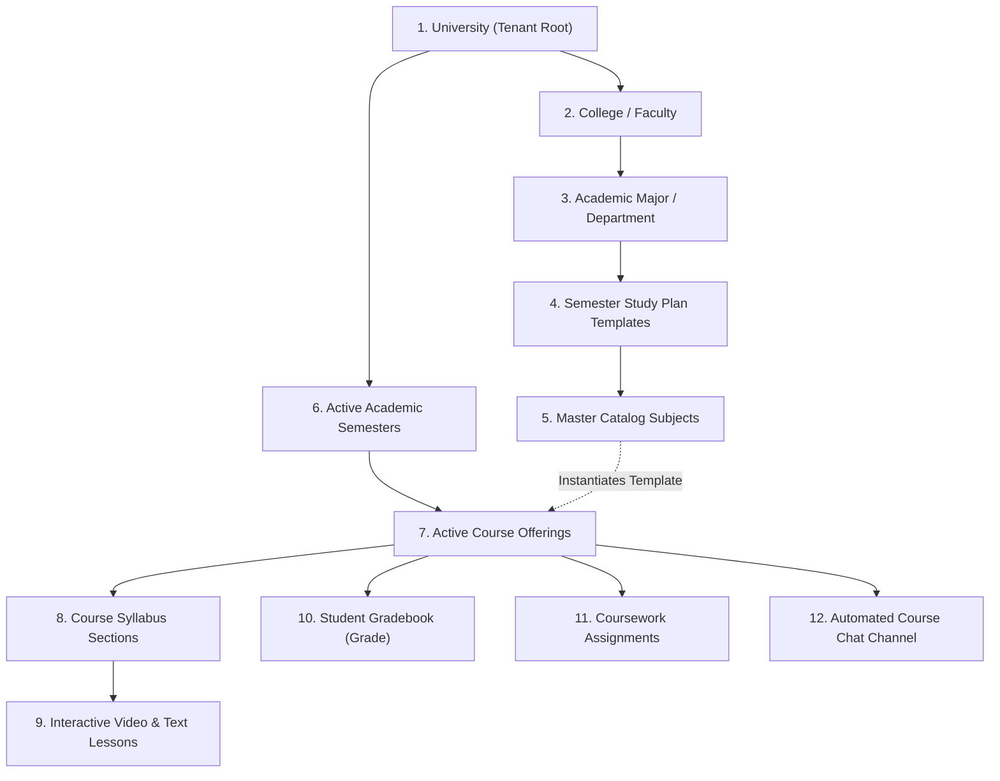

# Software Requirements Specification (SRS)
# Gahbaz Higher Education Academic & E-Learning Platform

- **Project Name:** Gahbaz Integrated Academic Management & Learning Platform (LMS & SIS)
- **Document Version:** 1.0.0 (Strict Technical Baseline)
- **Standard:** ISO/IEC/IEEE 29148:2018 / IEEE Std 830-1998
- **Date:** 2026-10-15
- **Status:** Approved Baseline Specification
- **Primary Language:** English (Technical Documentation) | Arabic (Application Interface & Academic Domain)

---

## Table of Contents
1. [Introduction & Strategic Mission](#1-introduction--strategic-mission)
   - 1.1 Purpose
   - 1.2 Core Problem Statement
   - 1.3 System Scope & Boundaries
   - 1.4 Definitions, Acronyms, and Abbreviations
2. [Overall System Description & Architecture](#2-overall-system-description--architecture)
   - 2.1 Multi-Tenant Institutional Architecture
   - 2.2 Academic Domain Supply Chain & Hierarchy
   - 2.3 User Classes & Personas
   - 2.4 Operating Environment & Technology Stack
3. [Domain Data Dictionary & Schema Specifications](#3-domain-data-dictionary--schema-specifications)
   - 3.1 Tenant & System Models (`University`, `AuditLog`, `PerformanceMetric`)
   - 3.2 User & Identity Discriminators (`User`, `Admin`, `Teacher`, `Student`)
   - 3.3 Institutional Structure Models (`College`, `Major`, `Subject`, `SemesterTemplate`)
   - 3.4 Operational Delivery Models (`Semester`, `Course`, `Section`)
   - 3.5 Academic Performance Models (`Grade`, `Assignment`, `Submission`)
   - 3.6 Communication Models (`Chat`, `Message`)
4. [Role-Based Access Control (RBAC) Matrix](#4-role-based-access-control-rbac-matrix)
5. [Detailed Functional Requirements by Operational Module](#5-detailed-functional-requirements-by-operational-module)
   - 5.1 Authentication & Session Management (`/api/v1/auth`)
   - 5.2 User & Profile Administration (`/api/v1/users`, `/students`, `/teachers`, `/admins`)
   - 5.3 Academic Structure & Curriculum Management (`/api/v1/colleges`, `/majors`, `/subjects`, `/semester-templates`)
   - 5.4 Academic Semester Lifecycle & Term Launch (`/api/v1/semesters`)
   - 5.5 Course Delivery, Sections & Lesson Authoring (`/api/v1/courses`, `/sections`)
   - 5.6 Student Course Enrollment & Add/Drop Portal (`/api/v1/enrollment`)
   - 5.7 Continuous Assessment & Faculty Gradebook (`/api/v1/grades`)
   - 5.8 Assignments & Student Submissions Engine (`/api/v1/assignments`)
   - 5.9 Cumulative GPA & Official Academic Transcript Engine (`/api/v1/transcripts`)
   - 5.10 Real-Time Course Channels & Collaboration (`/api/v1/chats`, `/messages`, WebSockets)
   - 5.11 System Governance, Health Metrics & Audit Trails (`/api/v1/system`)
6. [Non-Functional Requirements (NFRs)](#6-non-functional-requirements-nfrs)
   - 6.1 Security & Multi-Tenant Data Isolation
   - 6.2 Data Integrity & ACID Transactions
   - 6.3 Performance, Indexing & Pagination
   - 6.4 Usability & Localization (Arabic RTL)
7. [External Interfaces & Communications](#7-external-interfaces--communications)
8. [Traceability & Verification Standards](#8-traceability--verification-standards)

---

## 1. Introduction & Strategic Mission

### 1.1 Purpose
This Software Requirements Specification (SRS) defines the formal, complete, and unambiguous functional and non-functional requirements for the **Gahbaz Higher Education Academic & E-Learning Platform**. It serves as the single source of truth (SSOT) for software engineers, database architects, QA testers, and university administrators.

### 1.2 Core Problem Statement
Traditional university operations require extensive in-person administrative presence and manual, repetitive paperwork:
- Physical paper student course registrations and manual quota checks.
- Fragmented lecture delivery relying on external, unintegrated tools.
- Disconnected manual spreadsheets for midterm, coursework, and final grades.
- Slow, error-prone manual GPA calculations and delayed official transcript issuances.
- Disconnected communication channels between professors and enrolled students.

**Gahbaz** eliminates these manual operational bottlenecks by providing an end-to-end cloud platform allowing university administrators, professors, and students to conduct and manage the entire higher education lifecycle remotely with zero paper dependency.

> [!IMPORTANT]
> **Foundational Principle: Major-Driven Automatic Course Assignment**  
> In Gahbaz, students never undergo tedious, manual, course-by-course registration for their standard curriculum. Each student is matriculated into an academic **Major** (`student.major`). The Major maintains a predefined benchmark study plan (`SemesterTemplate`) for every academic level (Level 1, Level 2, ...).  
> When university administrators initiate a new semester for that major, the platform **automatically instantiates the courses and assigns them directly to all enrolled students at that level**. Immediately upon term launch, the student's class schedule, syllabus, gradebook entries, and discussion channels are active and populated without any student intervention.

### 1.3 System Scope & Boundaries
- **In Scope:**
  - Multi-tenant university partitioning with strict tenant boundary enforcement.
  - Institutional hierarchy definition (Colleges, Majors, Study Plan Templates, Master Subject Catalog).
  - One-click semester launch automating course generation, student cohort pre-enrollment, gradebook generation, and discussion channel setup with ACID transaction guarantees.
  - Hybrid self-service Add/Drop portal with prerequisite enforcement and 12–19 credit hour limits.
  - Digital syllabus delivery supporting structured sections, video lecture streaming, and rich-text topics.
  - Coursework assignment creation, digital file uploads (PDF/ZIP), automated late tracking, and grading workflows.
  - Gradebook recording and editing with automatic total/percentage recalculations.
  - Standard 4.0 GPA engine calculating term SGPA, cumulative CGPA, honor standings, and printable official transcripts.
  - Synchronized course discussion rooms with automated student roster membership.
  - Real-time system health telemetry (CPU, RAM, Uptime) and security audit logs.
- **Out of Scope (Current Baseline):**
  - Integrated third-party payment gateways for tuition fees (handled via university bursar external records).
  - Native video conferencing/live streaming server (video delivery operates via secure hosted video URLs).

### 1.4 Definitions, Acronyms, and Abbreviations
- **LMS:** Learning Management System (Course delivery, lectures, assignments).
- **SIS:** Student Information System (Academic records, enrollment, gradebooks, transcripts).
- **SGPA:** Semester Grade Point Average (Term GPA calculated on a 4.0 scale).
- **CGPA:** Cumulative Grade Point Average (Career GPA across all completed semesters).
- **ACID:** Atomicity, Consistency, Isolation, Durability (MongoDB Multi-Document Transactions).
- **RBAC:** Role-Based Access Control.
- **SSOT:** Single Source of Truth.
- **Tenant:** An individual university institution registered in the system identified by a unique `universityId`.

---

## 2. Overall System Description & Architecture

### 2.1 Multi-Tenant Institutional Architecture
Gahbaz is engineered as a multi-tenant platform. Every institutional resource (`College`, `Major`, `Subject`, `Semester`, `Course`, `Chat`, `User`) is strictly scoped to a `University` identifier:
```text
[Global Platform]
       │
       ▼
 [University Tenant A]                   [University Tenant B]
   ├── Colleges & Majors                   ├── Colleges & Majors
   ├── Master Subject Catalog              ├── Master Subject Catalog
   ├── Active Semesters & Courses          ├── Active Semesters & Courses
   └── Enrolled Students & Faculty         └── Enrolled Students & Faculty
```
**Isolation Rule:** Users authenticated under Tenant A can never read, modify, or list resources belonging to Tenant B. The `super-admin` role maintains global cross-tenant oversight for platform provisioning.

### 2.2 Academic Domain Supply Chain & Hierarchy
The academic domain models the physical university organizational chain:


1. **University:** Institutional root container.
2. **College:** Broad faculty division (e.g., Computer Science, Engineering, Medicine) defining program semester length (`numberOfSemesters`).
3. **Major:** Specific academic degree program (e.g., Software Engineering, Cyber Security).
4. **Semester Template:** Prescribed benchmark curriculum for each level (Level 1, Level 2, ... Level 8).
5. **Subject:** Permanent academic catalog entry (Code, Name, Credit Hours, Prerequisites, Default Grading Schema).
6. **Semester:** Active temporal operational term (e.g., "Fall 2026/2027") with start date, end date, and Add/Drop deadline.
7. **Course:** Operational offering of a Subject during an active Semester, assigned to professors and enrolled students.
8. **Section:** Thematic unit or chapter within a Course (e.g., "Chapter 1: Network Protocols").
9. **Lesson:** Granular educational item within a Section (Video lecture or Rich-text reading).
10. **Grade:** Official academic score record linking a Student and a Course.
11. **Assignment:** Coursework deliverable published by an instructor with deadlines and maximum scores.
12. **Chat:** Real-time communication channel auto-provisioned for the course.

### 2.3 User Classes & Personas
- **Super Administrator (`super-admin`):** Global platform administrator. Provisions new universities, manages tenant licensing, and reviews cross-tenant analytics and security telemetry.
- **University Administrator (`admin`):** Institutional Chief Administrator. Configures colleges, programs, study plans, master subjects; executes semester launches; manages faculty and student admissions; monitors campus audit logs.
- **Faculty Member / Instructor (`teacher`):** Academic educator. Builds syllabus sections and lessons; streams educational content; creates assignments and grades submissions; maintains course gradebook; moderates course discussion rooms.
- **Student (`student`):** Enrolled learner. Accesses course syllabus, videos, and reading topics; submits coursework before deadlines; participates in course chat; reviews grades and GPA; requests course adjustments during Add/Drop; views and prints official academic transcripts.
- **Public / Unauthenticated Visitor (`guest`):** Public platform visitor. Views marketing landing pages, platform features, university directories, and initiates registration or login.

### 2.4 Operating Environment & Technology Stack
- **Backend Runtime:** Node.js (v18+ LTS, ES Modules).
- **Application Framework:** Express.js 4.x.
- **Database Engine:** MongoDB 6.0+ (Replica Set enabled for ACID multi-document transactions) via Mongoose 8.x ODM.
- **Real-Time Engine:** Socket.IO 4.x (WebSockets with polling fallback).
- **Security & Cryptography:** bcryptjs (password hashing, salt rounds: 10), jsonwebtoken (JWT authentication via HTTP-only cookies and Bearer headers), express-rate-limit, helmet, express-mongo-sanitize.
- **Testing Framework:** Vitest 2.x, Supertest.
- **Frontend Architecture:** React 18, Vite 5, Mantine v6 UI framework, TanStack React Query v5, Tabler Icons.
- **Localization:** Arabic-first layout (RTL direction via `stylis-plugin-rtl`) with Google Cairo typography, full English backend API and technical logs.

---

## 3. Domain Data Dictionary & Schema Specifications

### 3.1 Tenant & System Models

#### 3.1.1 `University`
| Field | Type | Required | Constraints / Default | Description |
|---|---|---|---|---|
| `_id` | ObjectId | Yes | Auto-generated PK | Unique university tenant identifier |
| `name` | String | Yes | Trimmed, 2–100 chars | Formal name of the university |
| `code` | String | No | Trimmed, uppercase | Short institution code (e.g., "GAHBAZ") |
| `admin` | ObjectId | No | Ref: `User` / `Admin` | Chief University Administrator account |
| `active` | Boolean | Yes | Default: `true` | Operational status of the institution |
| `createdAt` / `updatedAt` | Date | Auto | Timestamps | Standard audit timestamps |

#### 3.1.2 `AuditLog`
| Field | Type | Required | Constraints / Default | Description |
|---|---|---|---|---|
| `user` | ObjectId | No | Ref: `User` | Actor performing the action |
| `action` | String | Yes | Trimmed | Action description (e.g., `START_SEMESTER`, `LOGIN`) |
| `ip` | String | No | IPv4/IPv6 string | Originating client IP address |
| `userAgent` | String | No | String | Client browser/device string |
| `details` | Mixed | No | Object | Operational payload or audit metadata |
| `university` | ObjectId | No | Ref: `University`, Indexed | Tenant scoping identifier |
| `createdAt` | Date | Auto | Default: `Date.now` | Event timestamp |

#### 3.1.3 `PerformanceMetric`
| Field | Type | Required | Constraints / Default | Description |
|---|---|---|---|---|
| `cpuUsage` | Number | Yes | Percentage (0–100) | Server host CPU load snapshot |
| `memoryUsage` | Number | Yes | Percentage (0–100) | Server host RAM consumption snapshot |
| `uptime` | Number | Yes | Seconds | Process execution uptime |
| `timestamp` | Date | Auto | Default: `Date.now` | Telemetry capture timestamp |

---

### 3.2 User & Identity Discriminators

#### 3.2.1 `User` (Base Schema)
- **Discriminator Key:** `kind` (Enum: `User`, `Admin`, `Teacher`, `Student`).
| Field | Type | Required | Constraints / Default | Description |
|---|---|---|---|---|
| `_id` | ObjectId | Yes | Auto-generated PK | Unique user identifier |
| `firstName` | String | No | Trimmed, 2–50 chars | User's first name |
| `lastName` | String | No | Trimmed, 2–50 chars | User's surname |
| `name` | String (Virtual) | Auto | Computed | Concatenation of `firstName` and `lastName` |
| `email` | String | Yes | Unique, Lowercase, Valid email format | Primary authentication username |
| `password` | String | Yes | Hidden by default (`select: false`) | Bcrypt-hashed password string |
| `phone` | String | No | Trimmed string | Contact telephone number |
| `avatar` | String | No | Default: `""` | File path or URL to profile picture |
| `role` | String | Yes | Enum: `student`, `teacher`, `admin`, `super-admin`, `user` | Core RBAC role |
| `university` | ObjectId | No | Ref: `University`, Indexed | Scoped university tenant |
| `isAdmin` | Boolean | Yes | Default: `false` | Administrative privilege flag |
| `lastActivity` | Date | Auto | Default: `Date.now` | Throttled user activity timestamp |
| `createdAt` / `updatedAt` | Date | Auto | Timestamps | Standard audit timestamps |

#### 3.2.2 `Admin` (Extends `User`)
| Field | Type | Required | Constraints / Default | Description |
|---|---|---|---|---|
| `permissions` | String | Yes | Enum: `["r", "rw", "rd", "rwd"]`, Default: `"r"` | Granular administrative CRUD rights |
| `role` | String | Yes | Enum: `admin`, `super-admin`, `user` | Admin tier assignment |

#### 3.2.3 `Teacher` (Extends `User`)
| Field | Type | Required | Constraints / Default | Description |
|---|---|---|---|---|
| `specialization` | String | No | Trimmed string | Academic area of expertise |
| `courses` | Array[ObjectId] | No | Ref: `Course` | Actively or historically instructed courses |

#### 3.2.4 `Student` (Extends `User`)
| Field | Type | Required | Constraints / Default | Description |
|---|---|---|---|---|
| `major` | ObjectId | No | Ref: `Major` | Degree program in which student is matriculated |
| `comingSemester` | Number | Yes | Default: `0` | Next upcoming academic level index (0, 1, 2...) |
| `semesters` | Array[ObjectId] | No | Ref: `Semester` | Enrolled active and completed semesters |
| `grades` | Array[ObjectId] | No | Ref: `Grade` | Academic course assessment records |

---

### 3.3 Institutional Structure Models

#### 3.3.1 `College`
| Field | Type | Required | Constraints / Default | Description |
|---|---|---|---|---|
| `name` | String | Yes | Trimmed, 2–100 chars | College / Faculty title |
| `description` | String | No | Default: `""` | College description and overview |
| `numberOfSemesters` | Number | Yes | Min: `1`, Default: `8` | Program graduation duration in semesters |
| `majors` | Array[ObjectId] | No | Ref: `Major` | Departments housed within this faculty |
| `university` | ObjectId | Yes | Ref: `University`, Indexed | Tenant scoping identifier |

#### 3.3.2 `Major`
| Field | Type | Required | Constraints / Default | Description |
|---|---|---|---|---|
| `name` | String | Yes | Trimmed, 2–100 chars | Academic program title (e.g., "Computer Science") |
| `college` | ObjectId | Yes | Ref: `College`, Indexed, Alias: `collage` | Parent college faculty |
| `students` | Array[ObjectId] | No | Ref: `Student` | Matriculated students in this major |
| `semesterTemplates` | Array[ObjectId] | No | Ref: `SemesterTemplate` | Study plan templates for levels 1 through N |
| `semesters` | Array[ObjectId] | No | Ref: `Semester` | Operational terms launched for this program |

#### 3.3.3 `Subject` (Master Course Catalog Blueprint)
- **Discriminator Key:** `itemType` (Enum: `Subject`, `Course`).
| Field | Type | Required | Constraints / Default | Description |
|---|---|---|---|---|
| `name` | String | Yes | Trimmed, 2–100 chars | Official catalog subject title |
| `code` | String | No | Trimmed string | Standard catalog course code (e.g., "CS101") |
| `subtitle` | String | No | Default: `""` | Short descriptive tagline |
| `category` | String | No | Default: `""` | Domain category (Core, Elective, General) |
| `creditHours` | Number | Yes | Min: `1`, Max: `10`, Default: `3` | Standard credit units weighted in GPA |
| `prerequisites` | Array[ObjectId] | No | Ref: `Subject` | Required predecessor subjects needed to enroll |
| `college` | ObjectId | No | Ref: `College`, Indexed, Alias: `collage` | Faculty offering this subject |
| `teachers` | Array[ObjectId] | No | Ref: `Teacher` | Default designated instructors |
| `university` | ObjectId | No | Ref: `University`, Indexed | Tenant scoping identifier |
| `gradeSchema` | Object | Yes | `{ total: 100, grade: { 0: { name: "تكاليف", value: 20 }, 1: { name: "نصفي", value: 30 }, 2: { name: "نهائي", value: 50 } } }` | Default assessment breakdown schema |

#### 3.3.4 `SemesterTemplate` (Benchmark Study Plan)
| Field | Type | Required | Constraints / Default | Description |
|---|---|---|---|---|
| `name` | String | Yes | Trimmed, 2–50 chars | Plan level title (e.g., "Level 1", "Semester 1") |
| `major` | ObjectId | Yes | Ref: `Major`, Indexed | Program for which this template applies |
| `index` | Number | Yes | Default: `1` | Level index sequence (1, 2, 3...) |
| `active` | Boolean | Yes | Default: `false` | Indicates whether template is currently active |
| `subjects` | Array[ObjectId] | No | Ref: `Subject` | Master catalog subjects prescribed for this academic level. All subjects are strictly **mandatory core requirements** contributing to the student's graduation credits and final GPA. |

---

### 3.4 Operational Delivery Models

#### 3.4.1 `Semester` (Active Academic Term)
| Field | Type | Required | Constraints / Default | Description |
|---|---|---|---|---|
| `name` | String | Yes | Trimmed, 2–50 chars | Term label (e.g., "Fall Semester 2026/2027") |
| `major` | ObjectId | Yes | Ref: `Major`, Indexed | Major program for which term was launched |
| `template` | ObjectId | Yes | Ref: `SemesterTemplate` | Study plan template used to instantiate courses |
| `university` | ObjectId | Yes | Ref: `University`, Indexed | Tenant scoping identifier |
| `courses` | Array[ObjectId] | No | Ref: `Course` | Operational course offerings for this term |
| `students` | Array[ObjectId] | No | Ref: `Student` | Enrolled student cohort |
| `startDate` | Date | Yes | Default: `Date.now` | Term commencement date |
| `endDate` | Date | Yes | Required | Term conclusion date |
| `addDropDeadline`| Date | No | Optional timestamp | Deadline after which Add/Drop portal closes |
| `completed` | Boolean | Yes | Default: `false` | Academic term finalization status |

#### 3.4.2 `Course` (Extends `Subject`)
| Field | Type | Required | Constraints / Default | Description |
|---|---|---|---|---|
| `description` | String | No | Default: `""` | Detailed course overview and syllabus |
| `willLearn` | Array[String] | No | List of strings | Specific learning objectives / outcomes |
| `requirements` | Array[String] | No | List of strings | Qualitative course prerequisites / equipment |
| `status` | String | Yes | Enum: `["active", "done"]`, Default: `"active"` | Course operational state |
| `cover` | String | No | Default: `""` | Course header cover banner media path |
| `semester` | ObjectId | Yes | Ref: `Semester`, Indexed | Parent active semester |
| `sections` | Array[ObjectId] | No | Ref: `Section` | Syllabus thematic modules |
| `grades` | Array[ObjectId] | No | Ref: `Grade` | Linked student grade records |
| `students` | Array[SubDoc] | No | `[{ student: ObjectId (ref Student), grade: ObjectId (ref Grade) }]` | Active roster of enrolled students and grade links |

#### 3.4.3 `Section` & Embedded `Lesson`
- **Section Schema:**
| Field | Type | Required | Constraints / Default | Description |
|---|---|---|---|---|
| `name` | String | Yes | Trimmed, 2–50 chars | Module/Unit title (e.g., "Unit 1: Fundamentals") |
| `description` | String | No | Default: `""` | Summary of module topics |
| `order` | Number | Yes | Default: `0` | Display sequence order within course syllabus |
| `course` | ObjectId | Yes | Ref: `Course`, Indexed | Course offering to which section belongs |
| `studyTime` | Number | Auto | Computed sum of lessons | Total estimated duration in minutes |
| `lessons` | Array[Lesson] | No | Embedded SubDocument Array | Granular lectures and reading topics |

- **Embedded `Lesson` Schema:**
| Field | Type | Required | Constraints / Default | Description |
|---|---|---|---|---|
| `_id` | ObjectId | Auto | Auto-generated PK | Unique lesson identifier |
| `name` | String | Yes | Trimmed, 2–50 chars | Lecture or topic title |
| `description` | String | No | Default: `""` | Overview of lecture content |
| `type` | String | Yes | Enum: `["video", "text"]`, Default: `"video"` | Educational content modality |
| `url` | String | Cond. | Required if `type === "video"` | Media streaming URL |
| `topic` | String | Cond. | Required if `type === "text"` | Rich-text HTML content |
| `studyTime` | Number | Yes | Min: `0`, Default: `0` | Estimated completion time in minutes |

---

### 3.5 Academic Performance Models

#### 3.5.1 `Grade`
| Field | Type | Required | Constraints / Default | Description |
|---|---|---|---|---|
| `course` | ObjectId | Yes | Ref: `Course`, Indexed | Associated course offering |
| `student` | ObjectId | Yes | Ref: `Student`, Indexed | Enrolled student receiving marks |
| `total` | Number | Yes | Min: `0`, Max: `100`, Default: `0` | Cumulative score across all components |
| `percent` | Number | Yes | Min: `0`, Max: `100`, Default: `0` | Percentage score used for GPA mapping |
| `grades` | Array[Item] | Yes | `[{ key: String, name: String, maxValue: Number, value: Number }]` | Structured evaluation breakdown |
| `grade` | Mixed | Yes | Legacy key-value map | Key-value breakdown map |

#### 3.5.2 `Assignment`
| Field | Type | Required | Constraints / Default | Description |
|---|---|---|---|---|
| `title` | String | Yes | Trimmed, 2–150 chars | Title of the homework / task |
| `description` | String | No | Default: `""` | Detailed instructions and submission guidelines |
| `course` | ObjectId | Yes | Ref: `Course`, Indexed | Course offering hosting assignment |
| `instructor` | ObjectId | Yes | Ref: `Teacher` | Faculty member who published assignment |
| `dueDate` | Date | Yes | Valid timestamp | Deadline for submission |
| `maxScore` | Number | Yes | Min: `1`, Default: `100` | Maximum points attainable |
| `attachmentUrl` | String | No | Default: `""` | Optional reference file or rubric attachment |

#### 3.5.3 `Submission`
| Field | Type | Required | Constraints / Default | Description |
|---|---|---|---|---|
| `assignment` | ObjectId | Yes | Ref: `Assignment`, Indexed | Parent assignment |
| `student` | ObjectId | Yes | Ref: `Student`, Indexed | Student author of the submission |
| `fileUrl` | String | Yes | Valid URI / path | Uploaded deliverable (PDF, ZIP, DOCX) |
| `notes` | String | No | Default: `""` | Student comment or repository link |
| `submittedAt` | Date | Auto | Default: `Date.now` | Precise upload timestamp |
| `isLate` | Boolean | Auto | Computed | `submittedAt > assignment.dueDate` |
| `score` | Number | No | Min: `0` | Faculty awarded score |
| `feedback` | String | No | Default: `""` | Qualitative instructor feedback |
| `status` | String | Yes | Enum: `["submitted", "graded", "returned"]` | Current workflow state |

---

### 3.6 Communication Models

#### 3.6.1 `Chat`
| Field | Type | Required | Constraints / Default | Description |
|---|---|---|---|---|
| `chatName` | String | Yes | Trimmed string | Discussion room title |
| `isGroupChat` | Boolean | Yes | Default: `false` | Direct (false) vs Group/Course (true) |
| `users` | Array[ObjectId] | Yes | Ref: `User` | Active participants |
| `course` | ObjectId | No | Ref: `Course`, Indexed | Optional automated link to Course offering |
| `latestMessage` | ObjectId | No | Ref: `Message` | Pointer to most recent message |
| `groupAdmin` | ObjectId | No | Ref: `User` | Room administrator (Instructor for courses) |
| `university` | ObjectId | No | Ref: `University`, Indexed | Tenant scoping identifier |

#### 3.6.2 `Message`
| Field | Type | Required | Constraints / Default | Description |
|---|---|---|---|---|
| `sender` | ObjectId | Yes | Ref: `User` | Message author |
| `content` | String | Yes | Trimmed string | Message text content |
| `chat` | ObjectId | Yes | Ref: `Chat`, Indexed | Parent discussion room |
| `readBy` | Array[ObjectId] | No | Ref: `User` | Users who have viewed message |

---

## 4. Role-Based Access Control (RBAC) Matrix

The table below strictly defines operational permissions by persona:

| Capability / Operational Endpoint | `super-admin` | `admin` | `teacher` | `student` | `guest` |
|---|:---:|:---:|:---:|:---:|:---:|
| **Platform Provisioning & University CRUD** | **Full** | Denied | Denied | Denied | Denied |
| **System Telemetry & Audit Logs (`/system`)** | **Full** | **Own Univ** | Denied | Denied | Denied |
| **Colleges, Majors, Catalog Subjects CRUD** | **Full** | **Own Univ** | Read Only | Read Only | Denied |
| **Semester Templates CRUD (`/semester-templates`)** | **Full** | **Own Univ** | Read Only | Read Only | Denied |
| **One-Click Term Launch (`/semesters/startSemester`)** | **Full** | **Own Univ** | Denied | Denied | Denied |
| **Semester Lifecycle (`/semesters` CRUD, End)** | **Full** | **Own Univ** | Read Only | Read Only | Denied |
| **Course Offering Management (`/courses` CRUD)** | **Full** | **Own Univ** | Assigned Only | Enrolled Only | Denied |
| **Syllabus Sections & Lessons Management** | **Full** | **Own Univ** | Assigned Only | Read Only | Denied |
| **Add/Drop Course Registration (`/enrollment`)** | **Full** | **Full** | Denied | **Self Only** | Denied |
| **Publish Assignments & Grade Submissions** | **Full** | **Own Univ** | Assigned Only | Denied | Denied |
| **Submit Assignments (`/assignments/.../submit`)** | Denied | Denied | Denied | **Self Only** | Denied |
| **Enter & Recalculate Grades (`/grades/:id`)** | **Full** | **Own Univ** | Assigned Only | Denied | Denied |
| **Inspect Official Transcript & GPA (`/transcripts`)** | **Full** | **Own Univ** | Assigned Only | **Self Only** | Denied |
| **Chat & Discussion Channels (`/chats`, `/messages`)** | **Full** | **Member** | **Member** | **Member** | Denied |
| **User Directory Management (`/students`, `/teachers`)** | **Full** | **Own Univ** | Read Only | Read Only | Denied |
| **Self Profile & Password Update (`/users/profile`)** | **Self** | **Self** | **Self** | **Self** | Denied |
| **Authentication (`/auth/login`, `/register`)** | Open | Open | Open | Open | **Open** |

---

## 5. Detailed Functional Requirements by Operational Module

### 5.1 Authentication & Session Management
- **FR-AUTH-001: User Login**
  - **Endpoint:** `POST /api/v1/auth/login`
  - **Actor:** Public / Any Registered User
  - **Input Schema:** `{ email: string, password: string }`
  - **Business Rules:**
    1. Authenticate against `User.findOne({ email }).select("+password")`.
    2. Validate password via `bcrypt.compare`.
    3. Rate limited: Maximum 10 attempts per 15 minutes per IP address.
    4. Issue signed JWT (HS256) containing `{ userId, role, universityId }` with 24-hour expiration (`1d`).
    5. Set JWT as HTTP-Only, secure cookie `token` and return in response JSON.
  - **Success Response (200):** `{ success: true, token: string, user: { _id, email, name, role, university } }`
  - **Errors:** `400 Bad Request` (Validation), `401 Unauthorized` (Invalid credentials), `429 Too Many Requests`.

- **FR-AUTH-002: User Registration**
  - **Endpoint:** `POST /api/v1/auth/register`
  - **Actor:** Public User
  - **Input Schema:** `{ firstName: string, lastName: string, email: string, password: string, phone?: string }`
  - **Business Rules:**
    1. Enforce strict input validation via Zod/Joi.
    2. Ensure email uniqueness (`User.exists({ email })`).
    3. Default role assignment: `"user"` / `"student"`. Prevent self-escalation to `admin` or `super-admin`.
    4. Password must be hashed via `hashPassword` before persistence.
  - **Success Response (201):** `{ success: true, message: "User registered successfully", user: { ... } }`

- **FR-AUTH-003: User Logout**
  - **Endpoint:** `POST /api/v1/auth/logout`
  - **Business Rules:** Clears HTTP-only `token` cookie and invalidates client session.

---

### 5.2 User & Profile Administration
- **FR-USR-001: Profile Retrieval & Self-Update**
  - **Endpoint:** `GET /api/v1/users/profile` | `PATCH /api/v1/users/:id`
  - **Actor:** Authenticated User
  - **Business Rules:** Users can update their `firstName`, `lastName`, `phone`, and `avatar`. Non-admin users cannot alter their own `role`, `isAdmin`, or `university` fields.

- **FR-USR-002: Role Directories (`Students`, `Teachers`, `Admins`)**
  - **Endpoints:** `GET /api/v1/students`, `GET /api/v1/teachers`, `GET /api/v1/admins`
  - **Actor:** `admin`, `super-admin`
  - **Business Rules:** Supports multi-tenant scoping (`university`), search queries, and standard pagination (`page`, `limit`).

---

### 5.3 Academic Structure & Curriculum Management
- **FR-STR-001: College Management**
  - **Endpoints:** `POST /api/v1/colleges`, `GET /api/v1/colleges`, `PATCH /api/v1/colleges/:id`, `DELETE /api/v1/colleges/:id`
  - **Actor:** `admin`, `super-admin`
  - **Business Rules:**
    - Query alias `/api/v1/collages` supported for backward compatibility.
    - Scoped strictly to `req.user.universityId`.
    - Deletion cascade check: Cannot delete college if associated majors exist unless confirmed.

- **FR-STR-002: Major Program Management**
  - **Endpoints:** `POST /api/v1/majors`, `GET /api/v1/majors`, `PATCH /api/v1/majors/:id`, `DELETE /api/v1/majors/:id`
  - **Actor:** `admin`, `super-admin`
  - **Business Rules:** Associated directly with parent `College`. Supports query filtering by `college`.

- **FR-STR-003: Master Catalog Subjects Blueprint**
  - **Endpoints:** `POST /api/v1/subjects`, `GET /api/v1/subjects`, `PATCH /api/v1/subjects/:id`, `DELETE /api/v1/subjects/:id`
  - **Actor:** `admin`, `super-admin`
  - **Business Rules:**
    - Sets catalog definition: Course Code, Name, Credit Hours (1–10), and Prerequisites (`prerequisites: [ObjectId]`).
    - Establishes baseline default `gradeSchema` (Default: 20 Coursework, 30 Midterm, 50 Final).
    - Serves as the blueprint when active term courses are spawned.

- **FR-STR-004: Semester Study Plan Templates**
  - **Endpoints:** `POST /api/v1/semester-templates`, `GET /api/v1/semester-templates`, `GET /api/v1/semester-templates/major/:majorId`, `PATCH /api/v1/semester-templates/:id`, `DELETE /api/v1/semester-templates/:id`
  - **Actor:** `admin`, `super-admin`
  - **Business Rules:**
    - Maps the prescribed catalog `subjects` for academic levels (Level 1 to Level N).
    - If template `name` is omitted, defaults to `"Semester {index}"`.

---

### 5.4 Academic Semester Lifecycle & Term Launch
- **FR-SEM-001: One-Click Term Launch (`startSemesterService`)**
  - **Endpoint:** `POST /api/v1/semesters/startSemester`
  - **Actor:** `admin`, `super-admin`
  - **Input Schema:**
    ```json
    {
      "semesterData": { "name": "Fall 2026", "startDate": "2026-09-01", "endDate": "2027-01-15", "addDropDeadline": "2026-09-21" },
      "semesters": ["templateId_1", "templateId_2"]
    }
    ```
  - **Business Rules (ACID Multi-Document Transaction):**
    1. Open atomic MongoDB session (`mongoose.startSession()`) and start transaction.
    2. For each selected `SemesterTemplate`:
       a. Identify eligible student cohort: Students where `major === template.major` and `comingSemester === template.index` (unconditionally enrolled; no administrative hold flags in this baseline).
       b. Create active `Semester` record bound to `universityId`.
       c. Mark `SemesterTemplate.active = true`.
       d. For each catalog `Subject` in the template:
          - Instantiate an active `Course` offering copying `name`, `code`, `creditHours`, `prerequisites`, `gradeSchema`, `teachers`.
          - Provision dedicated course discussion room (`Chat`) with instructor as `groupAdmin` and enrolled cohort as members.
       e. For each student in the cohort:
          - Advance `student.comingSemester += 1`.
          - Append `newSemester._id` to `student.semesters`.
          - Instantiate initialized `Grade` records (`total: 0, percent: 0`) for each generated course and link to `Course.students`.
       f. Attach generated courses and student list to `Semester`.
    3. Commit transaction. If any failure occurs, rollback all modifications cleanly.
  - **Success Response (200):** `{ success: true, message: "Semesters and courses started successfully" }`

- **FR-SEM-002: Semester Finalization & Deletion Safeguards**
  - **Endpoints:** `POST /api/v1/semesters/:id/end` | `DELETE /api/v1/semesters/:id`
  - **Business Rules:**
    - `end`: Sets `semester.completed = true` and frees `SemesterTemplate.active = false`.
    - `delete`: Executes cascade cleanup: removes enrolled semester IDs from `student.semesters`, deletes associated courses, and purges child syllabus sections.

---

### 5.5 Course Delivery, Sections & Lesson Authoring (LMS)
- **FR-CRS-001: Course Offerings Management**
  - **Endpoints:** `GET /api/v1/courses`, `GET /api/v1/courses/:id`, `PATCH /api/v1/courses/:id`, `DELETE /api/v1/courses/:id`
  - **Actor:** `admin`, `teacher` (assigned), `student` (enrolled)
  - **Business Rules:** Scoped to tenant. Delete course cascades deletion to sections, grades, chat channels, and pulls course reference from semesters.

- **FR-CRS-002: Syllabus Sections & Lessons Management**
  - **Endpoints:**
    - `GET /api/v1/sections?course=:courseId`
    - `POST /api/v1/sections` (Create Section)
    - `PATCH /api/v1/sections/:id` (Update Section)
    - `DELETE /api/v1/sections/:id` (Delete Section)
    - `POST /api/v1/sections/:sectionId/lessons` (Add Lesson)
    - `PATCH /api/v1/sections/:sectionId/lessons/:lessonId` (Update Lesson)
    - `DELETE /api/v1/sections/:sectionId/lessons/:lessonId` (Delete Lesson)
  - **Actor:** Assigned `teacher`, `admin`, `super-admin`
  - **Business Rules:**
    - Allows structuring course into ordered thematic sections.
    - Each lesson specifies `type: "video"` (requires valid media streaming `url`) or `type: "text"` (requires rich HTML `topic`).
    - Section `studyTime` automatically recalculated as the sum of lesson durations.

---

### 5.6 Student Course Enrollment & Add/Drop Portal

> [!NOTE]
> **Operational Context:**  
> As defined in §5.4 (`FR-SEM-001`), core course assignment is **100% automated upon semester launch** by the student's major. The Add/Drop Portal documented below serves as a **secondary adjustment window** allowing students to make optional modifications during the active enrollment period (e.g., dropping an optional course, balancing load between 12 and 19 credit hours, or registering for an elective or retake course).

- **FR-ENR-001: Available Courses Discovery**
  - **Endpoint:** `GET /api/v1/enrollment/available-courses`
  - **Actor:** Enrolled `student`
  - **Business Rules:**
    1. Identify student's active semester.
    2. Check Add/Drop window status (`isAddDropOpen`): Validates current date against `semester.addDropDeadline` (fallback: 14 days from `startDate`).
    3. Retrieve all course offerings in the semester.
    4. Calculate current registered credit hours.
    5. Evaluate prerequisites for each course against student's historical `Grade` records (requires `percent >= 60` or passed mark in prerequisite subject).
    6. Return courses marked with `isEnrolled`, `eligible`, and `missingPrerequisites`.
  - **Success Response (200):**
    ```json
    {
      "success": true,
      "data": {
        "semester": { "_id": "...", "name": "...", "isAddDropOpen": true },
        "currentCreditHours": 15,
        "minCreditHours": 12,
        "maxCreditHours": 19,
        "isAddDropOpen": true,
        "courses": [...]
      }
    }
    ```

- **FR-ENR-002: Course Registration (`Register`)**
  - **Endpoint:** `POST /api/v1/enrollment/register`
  - **Actor:** Enrolled `student`
  - **Input Schema:** `{ courseId: string }`
  - **Business Rules:**
    1. Reject with `400 Bad Request` if Add/Drop window has closed.
    2. Reject with `400 Bad Request` if student is already registered in the course.
    3. Reject with `400 Bad Request` if course prerequisites are not satisfied.
    4. Calculate new credit total (`currentCredits + course.creditHours`). Reject with `400 Bad Request` if total exceeds 19 credit hours.
    5. Create initialized `Grade` record for student and course.
    6. Add student and grade reference to `course.students`.
    7. Synchronize course chat channel (`syncCourseStudentRoster({ action: "add" })`).
  - **Success Response (200):** `{ success: true, message: "Enrolled in course successfully", data: { courseId, currentCreditHours } }`

- **FR-ENR-003: Course Drop (`Drop`)**
  - **Endpoint:** `POST /api/v1/enrollment/drop`
  - **Actor:** Enrolled `student`
  - **Input Schema:** `{ courseId: string }`
  - **Business Rules:**
    1. Reject with `400 Bad Request` if Add/Drop window has closed.
    2. Reject with `400 Bad Request` if student is not registered in the course.
    3. Calculate remaining credits (`currentCredits - course.creditHours`). Reject with `400 Bad Request` if remaining credits drop below 12 credit hours.
    4. Remove student from `course.students`.
    5. Delete associated `Grade` records for this course.
    6. Remove student from course discussion room (`syncCourseStudentRoster({ action: "remove" })`).
  - **Success Response (200):** `{ success: true, message: "Dropped course successfully", data: { courseId, currentCreditHours } }`

---

### 5.7 Continuous Assessment & Faculty Gradebook (SIS)
- **FR-GRD-001: Gradebook Entry & Recalculation**
  - **Endpoints:** `GET /api/v1/grades/course/:courseId` | `PATCH /api/v1/grades/:id`
  - **Actor:** Assigned `teacher`, `admin`, `super-admin`
  - **Input Schema:** `{ grade: { "0": { value: 18 }, "1": { value: 27 }, "2": { value: 45 } } }`
  - **Business Rules:**
    1. Validates that each item score does not exceed the maximum allowed points defined in `Subject.gradeSchema`.
    2. Automatically recalculates `total` score and `percent`.
    3. Dual fallback on `GET /api/v1/grades/:id`: If ID matches a `Grade`, returns grade; if ID matches a `Course`, returns full course student gradebook.

---

### 5.8 Assignments & Student Submissions Engine
- **FR-ASG-001: Assignment Publishing**
  - **Endpoint:** `POST /api/v1/courses/:courseId/assignments`
  - **Actor:** Assigned `teacher`, `admin`, `super-admin`
  - **Input Schema:** `{ title: string, description?: string, dueDate: Date, maxScore?: number, attachmentUrl?: string }`
  - **Business Rules:** Validates `dueDate` timestamp and persists assignment linked to `course`.

- **FR-ASG-002: Student Deliverable Submission**
  - **Endpoint:** `POST /api/v1/assignments/:assignmentId/submit`
  - **Actor:** Enrolled `student`
  - **Input Schema:** `{ fileUrl: string, notes?: string }`
  - **Business Rules:**
    1. Enforces student enrollment in parent course.
    2. Compares submission timestamp with `assignment.dueDate` to set `isLate: true/false`.
    3. Supports update/resubmission prior to instructor grading.

- **FR-ASG-003: Faculty Submission Evaluation**
  - **Endpoint:** `PATCH /api/v1/assignments/submissions/:submissionId/grade`
  - **Actor:** Assigned `teacher`, `admin`
  - **Input Schema:** `{ score: number, feedback?: string }`
  - **Business Rules:** Validates `0 <= score <= assignment.maxScore`. Updates status to `"graded"`.

---

### 5.9 Cumulative GPA & Official Academic Transcript Engine
- **FR-TRN-001: Standard 4.0 GPA Calculation Engine**
  - **Grading Scale Reference:**
    | Score Range (%) | Letter Grade | Grade Points | Status |
    |:---:|:---:|:---:|:---:|
    | 95 – 100 | **A+** | 4.00 | Passed |
    | 90 – 94 | **A** | 3.75 | Passed |
    | 85 – 89 | **B+** | 3.50 | Passed |
    | 80 – 84 | **B** | 3.00 | Passed |
    | 75 – 79 | **C+** | 2.50 | Passed |
    | 70 – 74 | **C** | 2.00 | Passed |
    | 65 – 69 | **D+** | 1.50 | Passed |
    | 60 – 64 | **D** | 1.00 | Minimum Pass |
    | 0 – 59 | **F** | 0.00 | Fail |
  - **Calculation Algorithms:**
    - $\text{Quality Points} = \text{Grade Points} \times \text{Course Credit Hours}$
    - $\text{SGPA} = \frac{\sum \text{Quality Points in Semester}}{\sum \text{Attempted Credit Hours in Semester}}$
    - $\text{CGPA} = \frac{\sum \text{Quality Points across All Semesters}}{\sum \text{Attempted Credit Hours across All Semesters}}$
    - **Academic Standing Rules:**
      - $\text{CGPA} \ge 3.50 \implies \text{امتياز (First Class Honors)}$
      - $3.00 \le \text{CGPA} < 3.50 \implies \text{جيد جداً (Very Good)}$
      - $2.00 \le \text{CGPA} < 3.00 \implies \text{جيد (Good Standing)}$
      - $\text{CGPA} < 2.00 \implies \text{تحت الملاحظة الأكاديمية (Academic Probation)}$
    - **Failed Course Policy:**
      - When a student fails a course ($\text{Grade} < 60\%$, letter grade `F`, 0.00 grade points), the failing result is permanently factored into the term SGPA and career CGPA.
      - Quality points contributed = 0, credit hours are counted in `Attempted Credits`, and `Earned Credits` = 0.
      - In this baseline, the system does not enforce automated retake scheduling, probation registration blocks, or academic suspension; the student continues their program progression according to their major's level sequence.

- **FR-TRN-002: Official Printable Academic Transcript Retrieval**
  - **Endpoints:** `GET /api/v1/transcripts/my-transcript` | `GET /api/v1/transcripts/student/:studentId`
  - **Actor:** `student` (Self), `admin`, `teacher`
  - **Business Rules:**
    1. Compiles student personal and institutional details.
    2. Aggregates chronologically enrolled semesters.
    3. Calculates term SGPA, credits attempted, credits earned, and itemized course records (Code, Title, Hours, Score, Letter, Points, Quality Points).
    4. Computes career CGPA and graduation standing.
    5. Formatted for high-fidelity `@media print` paper output with official stamps and registrar signature blocks.

---

### 5.10 Real-Time Course Channels & Collaboration
- **FR-CHT-001: Automated Course Channel Provisioning**
  - **Business Rules:** Instantiated automatically during semester launch or course creation (`ensureCourseChatChannel`). Sets instructor as `groupAdmin`.
- **FR-CHT-002: Roster Synchronization**
  - **Business Rules:** Triggered upon student enrollment (`$addToSet`) and drop (`$pull`), ensuring the channel members accurately reflect the active class list at all times.
- **FR-CHT-003: WebSocket Real-Time Messaging**
  - **Events:** `send_msg`, `msg_receive`, `typing`, `stop_typing`.

---

### 5.11 System Governance, Health Metrics & Audit Trails
- **FR-SYS-001: Health Telemetry & Administrative Dashboards**
  - **Endpoints:** `GET /api/v1/system/adminDashData`, `GET /api/v1/system/stats`
  - **Actor:** `admin`, `super-admin`
  - **Business Rules:** Returns real-time institutional metrics (Total Colleges, Majors, Courses, Faculty, Students) and host telemetry (CPU, RAM, Uptime).

---

## 6. Non-Functional Requirements (NFRs)

### 6.1 Security & Multi-Tenant Data Isolation
- **NFR-SEC-001:** Institutional queries must enforce `university: req.user.universityId`.
- **NFR-SEC-002:** Passwords hashed with bcrypt (salt rounds $\ge 10$).
- **NFR-SEC-003:** Authentication tokens transmitted in HTTP-only, SameSite cookies.
- **NFR-SEC-004:** Public authentication routes rate-limited to 10 requests per 15 minutes.
- **NFR-SEC-005:** Input payloads sanitized against NoSQL injection and XSS.

### 6.2 Data Integrity & ACID Transactions
- **NFR-DAT-001:** Multi-document operational flows (such as `startSemesterService`) must execute inside MongoDB replica set sessions with full automatic rollback on error.
- **NFR-DAT-002:** Course deletions must cascade to clean up child sections, grades, chat channels, and semester course lists.

### 6.3 Performance, Indexing & Pagination
- **NFR-PER-001:** All listing endpoints must support standard pagination (`page`, `limit`) with page limits clamped to 100 items.
- **NFR-PER-002:** Mandatory database indexes on foreign keys: `university`, `college`, `major`, `semester`, `course`, `student`.

### 6.4 Usability & Localization (Arabic RTL)
- **NFR-USE-001:** User interface must render natively in Arabic RTL orientation using Google Cairo font.
- **NFR-USE-002:** Dark/Light theme toggle with persistent user preference storage.
- **NFR-USE-003:** Full responsive support across desktop, tablet, and mobile devices.

---

## 7. External Interfaces & Communications

### 7.1 REST API Architecture
- Base URL: `http://localhost:5000/api/v1`
- Protocol: HTTP/1.1 & HTTP/2, JSON request/response payloads.
- OpenAPI Specification: Maintained live at `/api/docs` (Swagger UI) and `/api/docs.json`.

### 7.2 WebSocket Protocol
- Real-time communication powered by Socket.IO on port 5000.
- Authenticated handshake verifying user identity.

---

## 8. Traceability & Verification Standards

| SRS Requirement | Backend Implementation File | Vitest Verification Suite |
|---|---|---|
| **FR-AUTH-001 / 002** | `modules/auth/auth.controller.js` | `tests/modules/auth.test.js`, `core/rate-limit.test.js` |
| **FR-STR-001 - 004** | `modules/colleges/`, `majors/`, `subjects/` | `tests/modules/academics-crud.test.js`, `semester-templates.test.js` |
| **FR-SEM-001 / 002** | `modules/semesters/semesters.service.js` | `tests/modules/semester-transaction.test.js`, `cascade-delete.test.js` |
| **FR-CRS-001 / 002** | `modules/courses/courses.service.js` | `tests/modules/sections-routes.test.js` |
| **FR-ENR-001 - 003** | `modules/enrollment/enrollment.service.js` | `tests/modules/enrollment.test.js` |
| **FR-ASG-001 - 003** | `modules/assignments/assignments.service.js` | `tests/modules/assignments.test.js` |
| **FR-GRD-001** | `modules/grades/grades.service.js` | `tests/modules/grades-route-fallback.test.js` |
| **FR-TRN-001 / 002** | `modules/transcripts/transcripts.service.js` | `tests/modules/transcripts.test.js` |
| **FR-CHT-001 - 003** | `modules/chat/chat.service.js` | `tests/modules/auto-course-chat.test.js`, `chat.test.js` |
| **NFR-SEC-001** | `core/middleware/rbac.middleware.js` | `tests/core/tenant-isolation.test.js` |
| **NFR-DAT-001** | `modules/semesters/semesters.service.js` | `tests/modules/semester-transaction.test.js` |

---
*End of Software Requirements Specification (SRS) - Gahbaz Higher Education Platform*
